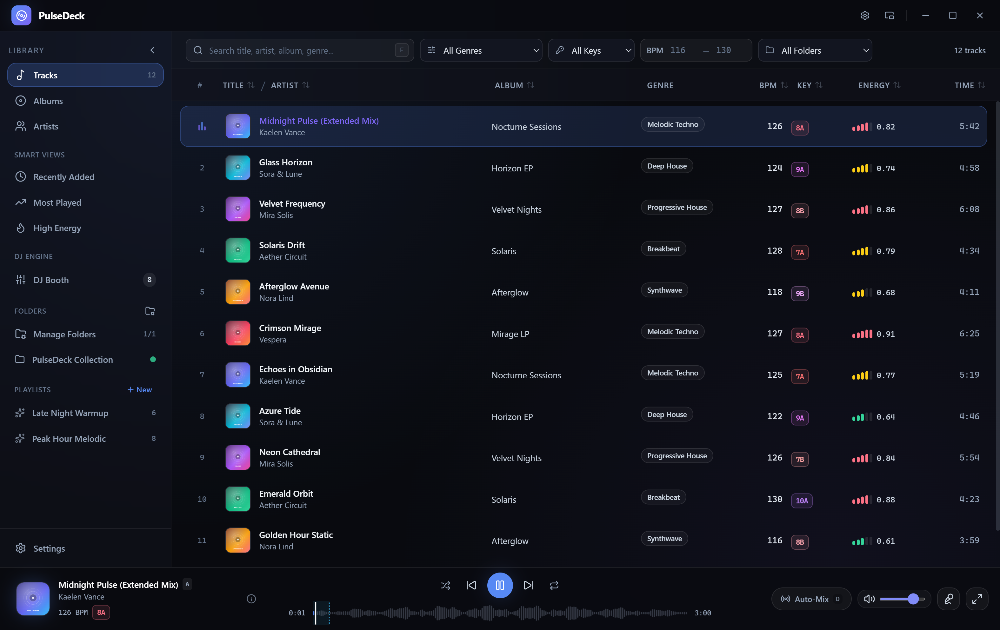
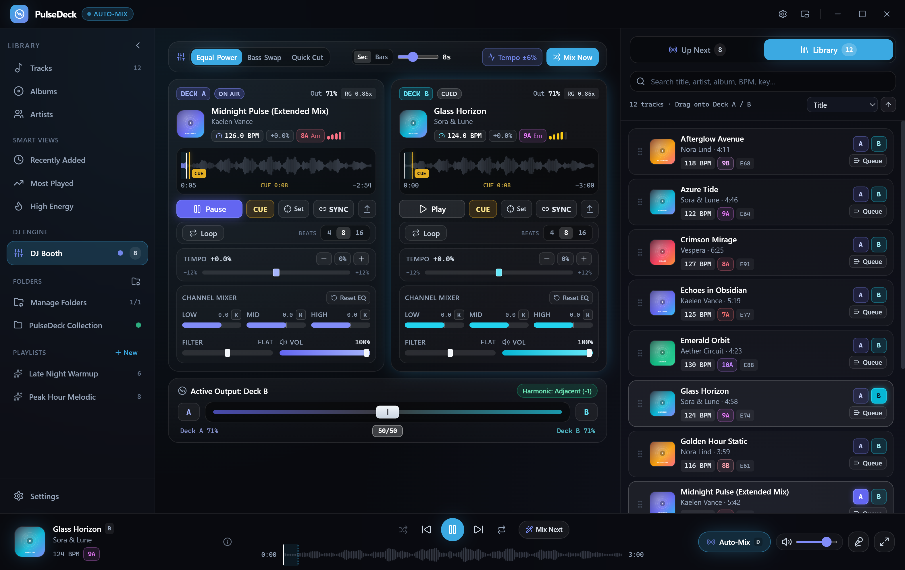
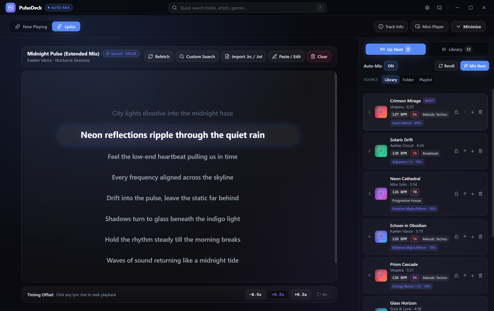
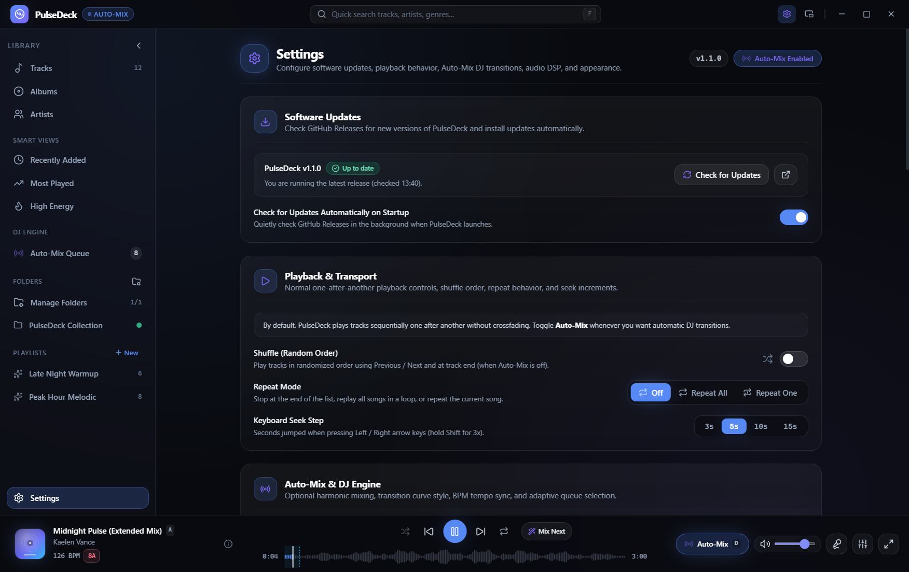

# PulseDeck

A sleek, dark-first desktop music player for **Windows**, **macOS**, and **Linux** with local library indexing, background DSP audio analysis, synced lyrics, a built-in metadata editor, automatic GitHub updates, and an optional Dual-Deck Auto-Mix DJ engine.

---

## Screenshots

<table>
  <tr>
    <td><strong>DJ Booth: Dual-Deck Controls, Drag &amp; Drop &amp; Library Browser</strong> </td>
    <td><strong>Synced Lyrics &amp; Now Playing</strong> </td>
  </tr>
  <tr>
    <td colspan="2" align="center"><strong>Settings &amp; Automatic GitHub Updates</strong> </td>
  </tr>
</table>

---

## Download

Download the latest installers from the [**Releases**](https://github.com/davide108/pulsedeck/releases/latest) page:

### Windows (10 / 11 x64)
- **`PulseDeck-Setup-1.3.4.exe`** — Standard Windows installer (Start Menu & Desktop shortcuts, uninstaller, and automatic in-app updates)
- **`PulseDeck-1.3.4-portable.exe`** — Portable executable (runs directly without installation)

> **Windows SmartScreen Note:** Because PulseDeck is currently unsigned, Windows may display *"Windows protected your PC"* on first launch. Click **More info** → **Run anyway** to proceed.

### macOS (Apple Silicon & Intel)
- **`PulseDeck-1.3.4-mac-arm64.dmg`** — For Apple Silicon Macs (M1 / M2 / M3 / M4)
- **`PulseDeck-1.3.4-mac-x64.dmg`** — For Intel Macs

> **macOS Gatekeeper Note:** Because builds are currently unsigned/notarized, macOS may warn that the app cannot be verified on first launch. Open **System Settings → Privacy & Security → Open Anyway**, or run `xattr -cr /Applications/PulseDeck.app` after dragging PulseDeck into Applications.

### Linux (x64 — Ubuntu, Debian, Fedora, Arch, Mint, openSUSE)
- **`PulseDeck-1.3.4-linux-x86_64.AppImage`** (`.AppImage`) — Universal runnable for all major Linux distros with **automatic in-app updates** (`chmod +x PulseDeck-1.3.4-linux-x86_64.AppImage && ./PulseDeck-1.3.4-linux-x86_64.AppImage`; on Ubuntu 24.04+, install `libfuse2t64` / `libfuse2` if needed)
- **`PulseDeck-1.3.4-linux-amd64.deb`** (`.deb`) — Ubuntu, Debian, Linux Mint, Pop!_OS (`sudo apt install ./PulseDeck-1.3.4-linux-*.deb`)
- **`PulseDeck-1.3.4-linux-x86_64.rpm`** (`.rpm`) — Fedora, RHEL, Nobara, openSUSE (`sudo dnf install ./PulseDeck-1.3.4-linux-*.rpm`)

---

## Features

### Music Library & Playback
- **Normal Playback by Default:** Plays tracks sequentially one after another with **Previous**, **Play/Pause**, **Next**, **Shuffle** (`S`), and **Repeat** (`R` — Off, Repeat All, Repeat One).
- **Watched Folders & File Watching:** Add, toggle, or rescan local music folders with automatic live updates when files are added, modified, or removed.
- **Wide Format Support:** Supports `.mp3`, `.flac`, `.wav`, `.ogg`, `.m4a`, `.aac`, and `.opus` with clean filename fallback parsing (`Artist - Title`) when tags are missing.
- **Instant Search & Smart Views:** Fast SQLite-backed filtering by Track, Artist, Album, Genre, BPM range, Camelot Key, and Source Folder, plus custom Playlists and Smart Views (*Recently Added*, *Most Played*, *High Energy*).
- **Multi-Artist Support:** Comma-separated artist tags (e.g. `Artist A, Artist B`) and multi-value audio tags are automatically split and merged case-insensitively in the **Artists** view (while preserving exceptions like `Tyler, The Creator` and `Earth, Wind & Fire`), and also inform Auto-Mix anti-repeat scoring and primary-artist lyrics fallback.

### DJ Booth, Dual-Deck Mixing & Optional Auto-Mix
- **Sidepanel DJ Booth:** Open **DJ Booth** directly from the left sidebar to access independent **Deck A** and **Deck B**, drag and drop tracks straight onto either deck (or click **`A` / `B`**), and browse either your **Up Next (Auto-Mix)** queue or your **Whole Library** with live search and sorting.
- **Full Per-Deck DJ Controls:** Independent **Play/Pause**, **Cue / Set Cue**, **BPM Sync**, **4 / 8 / 16 Beat Loops**, **Tempo ±12%** fader with pitch nudge & reset, **3-Band EQ** with per-band **Kill** switches, bipolar **LPF/HPF Color Filter**, **Channel Volume**, interactive dual waveforms, and an interactive **Crossfader** (`A` / `50/50` / `B`).
- **Opt-In Harmonic Auto-Mix (`D`):** Toggle **Auto-Mix** anytime to blend tracks automatically at outro cues using BPM proximity (including half/double-time), Camelot Wheel harmony, genre/energy flow, and anti-repeat scoring with **Equal-Power**, **Bass-Swap**, or **Quick Cut** transitions.
- **Transparent Queue & Real-Time Adaptation:** Lock, reorder, remove, reroll, or enqueue picks from your library. Manually selecting or skipping a track smoothly crossfades and re-anchors the Auto-Mix queue in the new direction.

### Synced & Static Lyrics (`L`)
- **Automatic Lookup (Synced First):** Automatically checks local `.lrc`/`.txt` sidecars, embedded tags, and **LRCLIB**, prioritizing time-synced LRC lyrics over static text.
- **Interactive Synced View:** Real-time line highlighting, smooth auto-scroll, click-any-line seeking, and persisted timing offset controls (`-0.5s` / `+0.5s`).
- **Import & Custom Search:** Import `.lrc` / `.txt` files, paste or edit lyrics directly, or run a custom title/artist search.

### Track Info & Metadata Editor (`I`)
- Right-click any track (or click the Info icon / press `I`) to inspect container, codec, bitrate, sample rate, channels, and file details.
- Edit **Title**, **Artist** (separate multiple artists with commas to preview and group them individually), **Album**, **Album Artist**, **Genre**, **Year**, **Track #**, **BPM**, **Musical/Camelot Key**, and **Cover Artwork**—all edits are preserved across folder rescans.

### Background Audio Analysis, Visuals & Automatic Updates
- **Non-Blocking DSP Analyzer:** Automatically computes BPM, Camelot key (`1A–12B`), ReplayGain loudness normalization, Energy score, 200-bar clickable waveforms, and intro/outro silence cues.
- **Dynamic Glassmorphic UI:** Accent colors adapt to the active track's album art (or pick your own preset in Settings), paired with a 60fps frequency spectrum visualizer and an always-on-top **Mini-Player** mode.
- **Low-End PC & Large-Library Performance:** Virtualized Track, Album, and Artist views, code-split lazy views, on-demand waveform peak loading, deduplicated 640px artwork caching, idle DSP worker cleanup, and a **Performance / Reduced Effects Mode** toggle in **Settings → Appearance & Interface** (replaces glass blur with solid surfaces, disables ambient glows, and caps visualizer FPS).
- **Automatic GitHub Updates:** Open **Settings → Software Updates** (or let PulseDeck check quietly on startup) to check GitHub Releases for new versions, download with live progress, and restart to install automatically on **Windows installer** and **Linux AppImage** builds (or jump straight to the matching direct download link for macOS, Linux `.deb`/`.rpm`, and Windows portable).

---

## Keyboard Shortcuts

| Shortcut | Action |
|---|---|
| `Space` | Play / Pause |
| `S` | Toggle Shuffle |
| `R` | Cycle Repeat (`Off` / `Repeat All` / `Repeat One`) |
| `D` | Toggle Auto-Mix |
| `M` | Mute / Unmute |
| `←` / `→` | Seek backward / forward (`Shift` for 3x) |
| `↑` / `↓` | Volume up / down (`±5%`) |
| `L` | Toggle Lyrics view |
| `I` | Open Track Info & Metadata Editor |
| `F` / `Ctrl + F` / `⌘ + F` | Focus library search |
| `Ctrl + ,` / `⌘ + ,` | Open Settings |
| `Esc` | Close active modal / Now Playing overlay |
| Media Keys | OS Play/Pause, Next, Previous, Stop |

---

## License

Released under the [MIT License](LICENSE).
